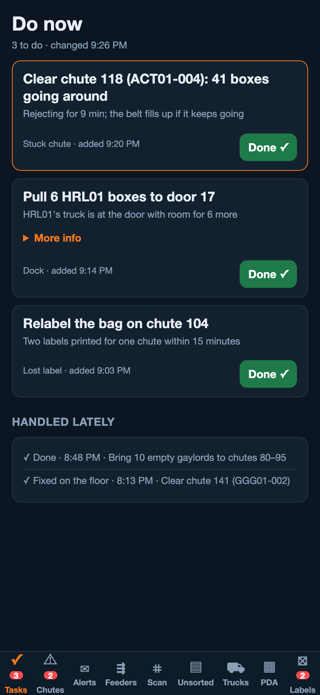
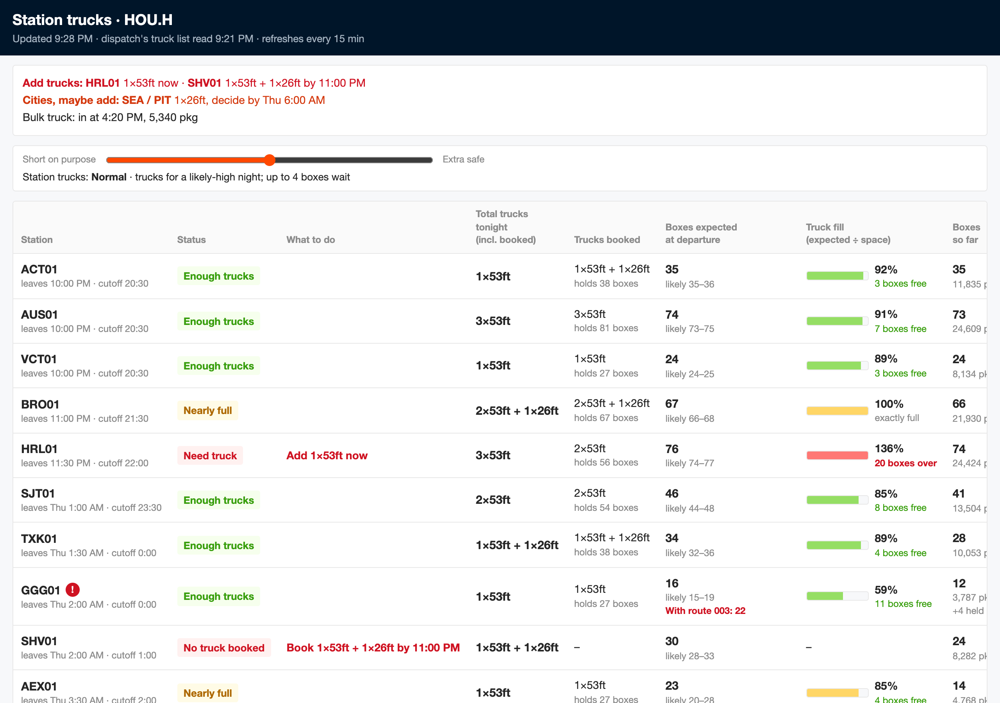
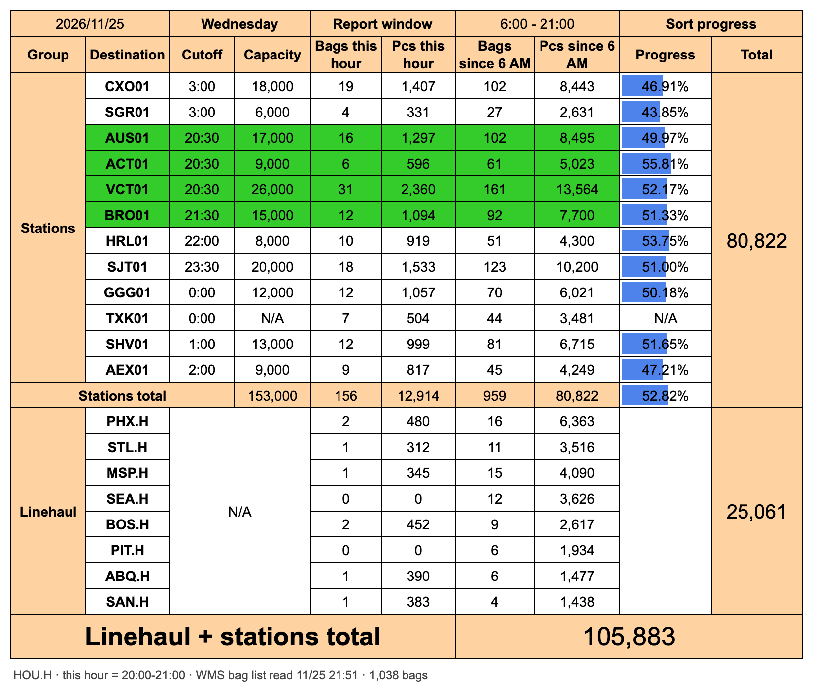
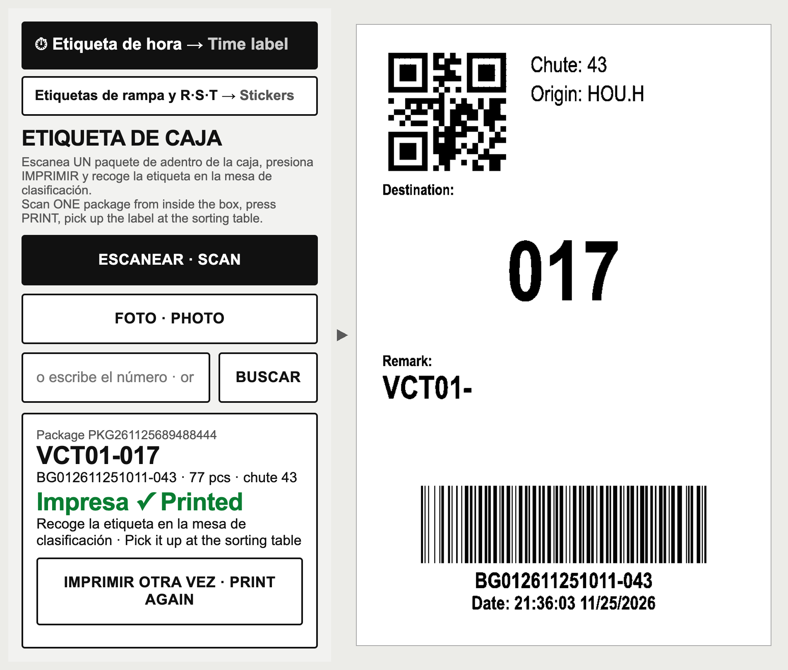

# HubOps: live floor tools for a parcel sort hub

I built this toolkit in under a month while working night shift at a high-volume parcel hub (up to 380,000 packages a day
across a cross-belt sorter, dozens of inbound linehaul trucks and a dozen delivery stations). The warehouse system
had all the data, but nobody on the floor could see it in time to act: how much freight was really left, which
chutes were jammed, which outbound truck needed boxes pulled right now. These tools read the warehouse system every
few minutes and turn it into short, specific instructions on a phone.

The sorting team and dispatch used it on the floor. This repository is a portfolio copy: the code, structure and logic
are the real system, but it runs against a **simulated warehouse system with synthetic data**. All company names,
locations, people, endpoints and data from the real site have been replaced.



## What it does

| Tool | What the floor gets |
|---|---|
| **Left to sort** (`hubops/unsorted_board.py`) | Truck by truck, how much freight is still unsorted, which gaylords were never scanned in (still on the trailer, or unloaded without a scan), and how many hours of belt time that is at the current pace. Splits tonight's freight from next day's, so the night knows what will carry over. |
| **Stuck chutes** (`hubops/chute_alerts.py`) | Every 2 minutes: chutes whose boxes are going around the belt because the gaylord is full or missing, how long, and how many boxes. Also catches spikes of "no rule" rejects and bursts of near-empty bags. |
| **Lost labels** (`hubops/lost_labels.py`) | Two bag labels printed for one chute within 15 minutes usually means a bag label got lost or covered. Flags the chute and the two bags. |
| **Feed stations** (`hubops/feeder_pace.py`) | Hourly: which feed stations are slow compared with their own normal, and which reject far more than the rest. |
| **Loading board** (`hubops/dock_board.py`) | For each outbound truck at a door: room left, boxes already loaded, and exactly how many to pull next. |
| **Truck forecast** (`web/src/truckspace.js`, `truckmodel.js`) | Forecasts each station's boxes at departure from tonight's count and its usual curve, compares with booked truck space, and tells dispatch to add or book a truck early enough to get one. A slider trades "short on purpose" against "extra safe". [Results below.](#truck-forecast-results) |
| **Floor coach** (`hubops/floor_coach.py`, `prompts/coach.md`) | Every hour, the last hour's floor snapshot (sorter speed, feed stations, stuck chutes, freight left, trucks) goes to an LLM with a set of floor rules, and at most four concrete floor moves are posted to the phone app. Runs offline with `--demo`. |
| **Hourly report** (`hubops/hourly_report.py`, `.github/workflows/hourly-report.yml`) | Every hour: bags and packages per destination, progress against each station's capacity, rendered to an image and posted to the team chat. It refuses to post when the data is short, stale or doesn't add up, and alerts instead. Replaced about 5 minutes of manual work every hour, and never missed an hour. |
| **Lookup** (`hubops/look.py`) | One command for any parcel, bag, gaylord, truck or destination: where it is, which truck brought it, whether the sorter read it, which bag it's in, what's still here for a station. |
| **Label station** (`web/src/labelstation.js`, `hubops/label_station.py`, `agent/`) | A worker scans one package from a box on any phone (or types it), the box is looked up in the warehouse system, and the right box label prints on the thermal printer at the sorting table. A small print agent on the table's laptop picks the printer by name, speaks TSPL/ZPL and updates itself. Bilingual (Spanish/English) for the floor crews. |
| **Live state** (`hubops/live_state.py`) | Ties everything together into one brief, every line stamped with when its own data was read. A dead job shows up as `!! BROKEN` instead of a stale number. |
| **Phone app** (`web/`) | A home-screen web app on Cloudflare Workers with Tasks, Chutes, Alerts, Feeders, Unsorted and Trucks tabs, plus web push. Anything someone has to physically do goes on one ranked task list, buzzes once, and clears itself when the data shows it's handled. |



## Truck forecast results

Every night the forecast recorded its 9 AM truck call for each station next to the trucks dispatch actually
booked, then judged both against the boxes that really left (a call is "short" when 5 or more boxes didn't fit).
Over 14 nights of live use (140 station-nights):

| | Right number of trucks | Short (5+ boxes left behind) | One truck too many |
|---|---|---|---|
| Forecast, 9 AM call | **62%** | **26%** | 11% |
| Dispatch, final bookings | 56% | 38% | 6% |

The forecast's 9 AM call was right more often than dispatch's final bookings, made later in the day with more
information, and left freight behind about 30% less often. It deliberately plans with a margin, so it books one
truck too many a little more often.

Before going live it was tuned on one period and tested on a later period it had never seen. It forecasts from a
self-weighting mix of methods (tonight's pace against the station's usual curve, station and hub-wide corrections),
and the spread of its range grows with the square root of the forecast, so small stations don't get false alarms.
The scoring code is `weeklyScore` in `web/src/truckspace.js`; the numbers above come from the real deployment and
can't be reproduced from the synthetic data in this repository.

## How it fits together

```
 warehouse system (WMS)          hubops/ (Python, runs on a small always-on host)
 ─────────────────────           ──────────────────────────────────────────────
 bags, scans, sorter records ──▶ unsorted_board · chute_alerts · lost_labels
 truck tasks, feed stations      feeder_pace · dock_board · floor_now · look
                                 floor_coach (LLM) · hourly_report
                                         │
                                         ▼  live_state (one brief, with a watchdog)
                                 do_now (task list) · app_push
                                         │
                                         ▼
 web/ (Cloudflare Worker + KV) ──▶ phone app, truck forecast page, unsorted board, web push
```

- **Python 3, standard library only** for the floor tools and the simulator.
- **Cloudflare Workers + KV** for the phone app, the forecast and the shared pages; cron triggers every 5 minutes
  and hourly.
- **Web Push** (VAPID) for alerts that need someone to move.
- Every number shown carries the time its own data was read, and the code refuses to show it past its age limit.

## Run it

Requirements: Python 3.9+, Node 22.5+ (for the web part; on older Node a few database tests are skipped).

```bash
./scripts/demo.sh
```

This starts the simulated warehouse system on `127.0.0.1:8765`, runs every floor tool once against it and prints
the live-state brief. Sample output:

```
== stuck chutes
STL.H (chute 050) · STILL stuck 24 min · 319 boxes going around · since 9:02 PM
SEA.H (chute 052) · stuck 7 min · 96 boxes going around · since 9:19 PM
No chute (NO_MATCHED_RULE) · 215 rejects / 83 boxes in 20 min

== lost labels
Chute 53 · BOS.H · 2 labels 1 min apart · 9:20 PM
  BG012611250925-053 51 pcs 9:19 PM → BG012611250934-053 6 pcs 9:20 PM
  scan the gaylord at chute 53

== feed stations
Feed stations 8–9 PM · 18,821 fed (normal 18,729)
Slow: 2: 208 (expected 535)
Rejects: 16: 7.2% (every night) · avg 1.8%
```

Individual tools (with the simulator running: `python3 hubsim/server.py`):

```bash
python3 hubops/look.py AUS01           # what's still here for a station
python3 hubops/unsorted_board.py --dry-run
python3 hubops/live_state.py --check
```

The phone app, locally with demo data:

```bash
cd web && npm run dev
```

Static previews that open in any browser are in `docs/` (`app-preview.html`, `trucks-preview.html`,
`unsorted-preview.html`).





The label station, against the simulator:

```bash
python3 hubsim/server.py &
python3 hubops/label_station.py --demo
python3 agent/label_agent.py --queue data/labels/queue.json --dry-run   # writes the printer commands to data/labels/
```

## Tests

```bash
python3 -m unittest discover tests     # 160 tests
cd web && npm test                     # 31 tests
```

## The simulator

`hubsim/` is a stand-in for the real warehouse system so the tools can run anywhere. It builds a deterministic
night at a hub: inbound linehaul trucks with gaylords (some unloaded, some still on the trailer, some arriving
later), pickup freight, a 30-station sorter running about 20,000 parcels an hour with realistic rejects, bags made
and signed out per chute, a few chutes that jam, a lost label, and outbound trucks at the doors. It serves the same
request and response shapes the tools expect. See `hubsim/ENDPOINTS.md`.

## Configuration

Environment variables (all optional for the demo):

| Variable | Use |
|---|---|
| `HUBOPS_WMS_URL`, `HUBOPS_WMS_TOKEN` | Warehouse system address and token (default: the simulator) |
| `HUBOPS_APP_URL`, `HUBOPS_APP_KEY` | The phone app's worker and its push key (unset = demo mode, writes to `data/`) |
| `HUBOPS_CHAT_WEBHOOK` | Optional team chat webhook for alerts and the hourly report |
| `ANTHROPIC_API_KEY`, `HUBOPS_COACH_MODEL` | The floor coach's LLM (unset = `--demo` with an example answer) |

Worker secrets are set with `wrangler secret put`; see `web/.dev.vars.example`.
